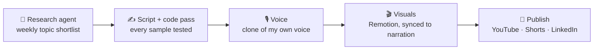

<h1 align="center">Hi, I'm Sushil 👋</h1>

  <b>Technical Architect · .NET · Integration architecture</b> 
  I connect systems that were never designed to talk to each other — ERPs, payment gateways, 
  EDI trading partners and e-invoicing networks — and make those integrations survive retries, 
  duplicate events and 2 a.m. failures.

  
  

---

### 🧩 Where I spend my time

| Domain | What that means in practice |
|---|---|
| 💳 **Payment gateways** | Webhooks, signature checks, idempotency, refunds, reconciliation |
| 🧾 **E-invoicing** | Government clearance and invoice networks, signed XML, compliance deadlines |
| 🔁 **EDI** | Trading-partner documents, mapping and transport between businesses |
| 🏭 **ERP integration** | Moving orders, invoices and stock between ERPs and everything around them |

---

### 🚧 Building now: ShielSoft

**ShielSoft** is a faceless YouTube channel about integration architecture in .NET, built as an automated pipeline.
Nothing gets voiced until its code compiles, passes its tests and has been run for real.

- **Research agent:** a .NET 10 worker on Azure Container Apps. It collects GitHub issues, Stack Overflow questions and .NET blog posts into Azure SQL, checks YouTube for how well each topic is already covered, and opens a weekly GitHub issue with a shortlist. I approve topics by ticking checkboxes.
- **Video 001, *Payment webhooks in ASP.NET Core*:** 62 tests, run on LocalDB and on SQL Server in Docker (Testcontainers), plus Stripe test-mode integration tests and real terminal captures. The code pass caught **7 errors** in the draft script before any of them reached the recording.

---

### 📐 Things I believe

- Every webhook arrives at least twice. Design for it.
- The script follows the code, never the reverse.
- An integration isn't done until it has a reconciliation job.
- Boring and observable beats clever and silent.

---

### 🛠️ Tools I use

---

  💬 Ask me about payment webhooks, e-invoicing or EDI, or tell me which integration keeps breaking for you. It might become a video.

